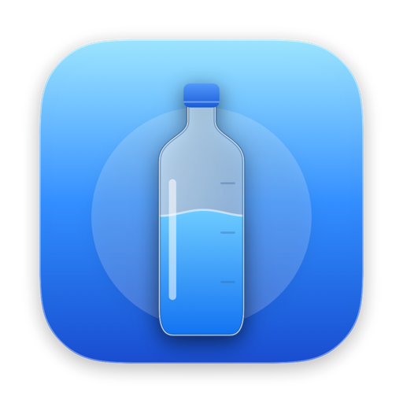
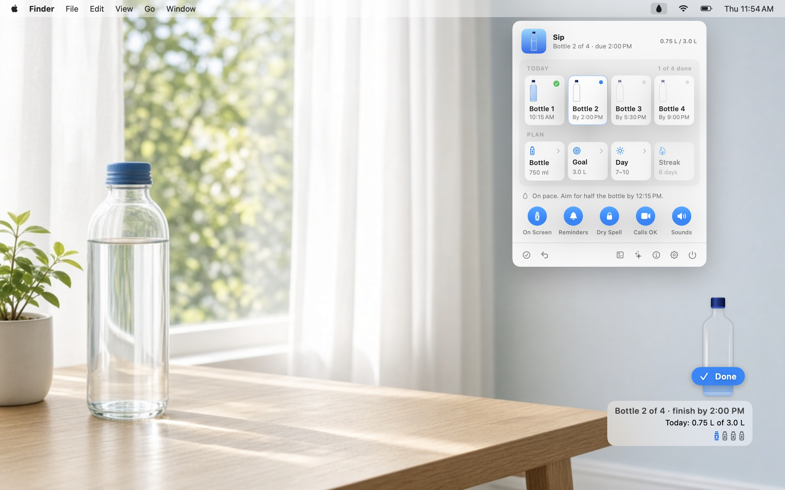
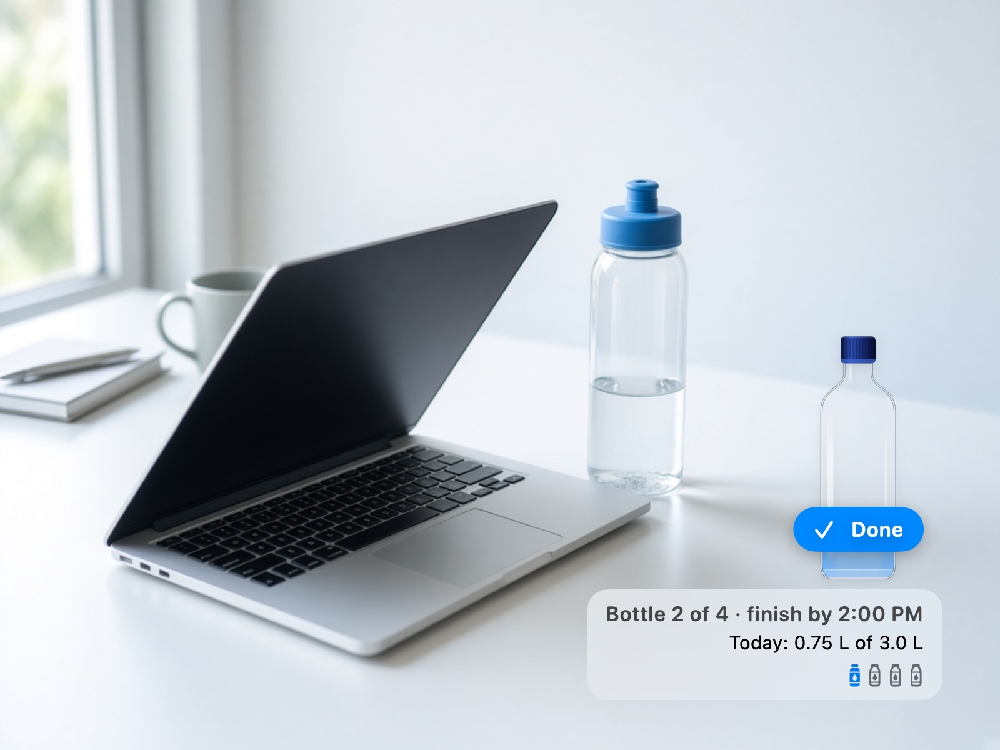
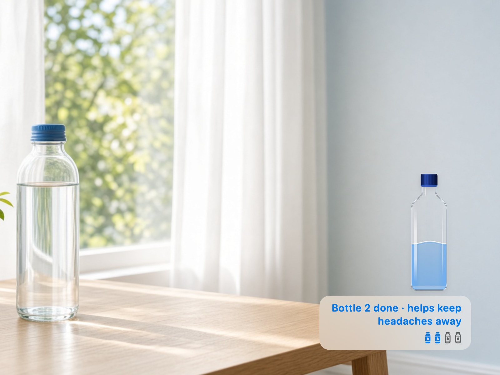
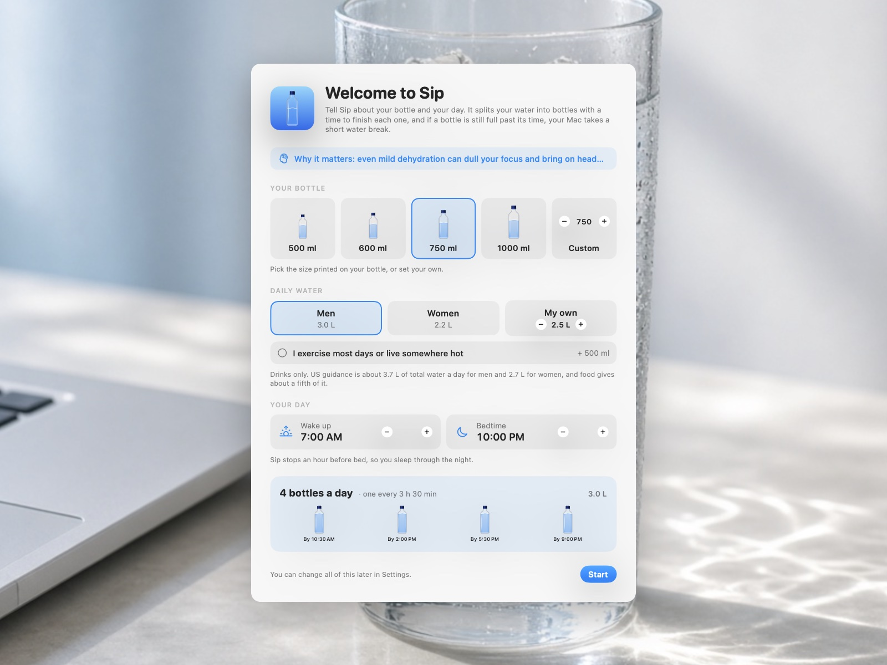
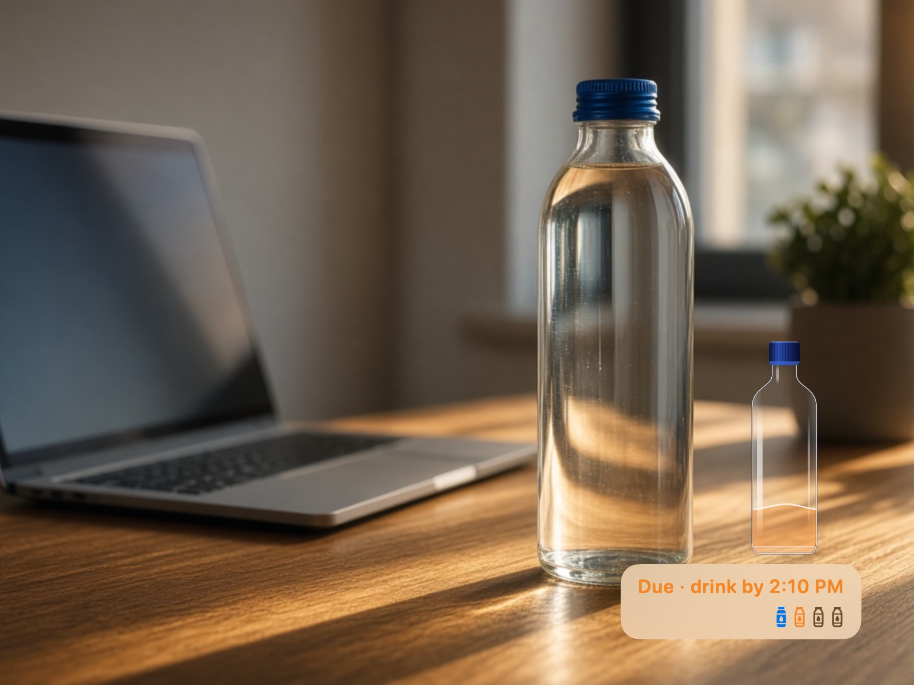
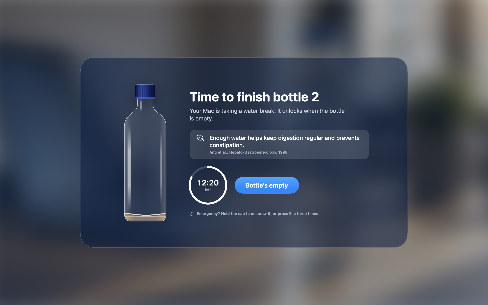
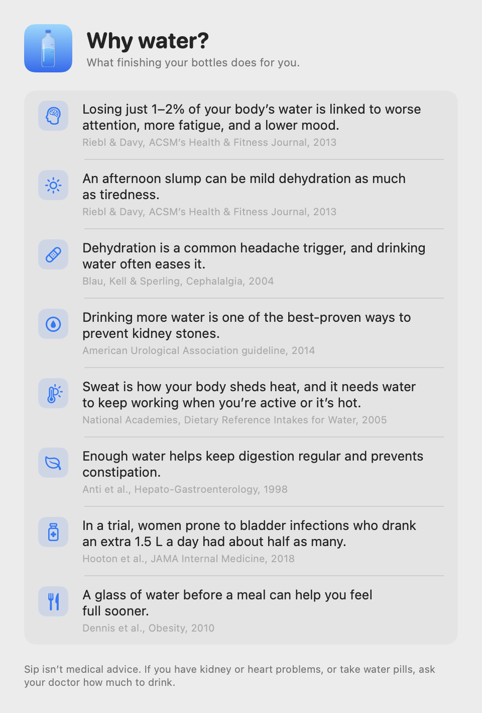
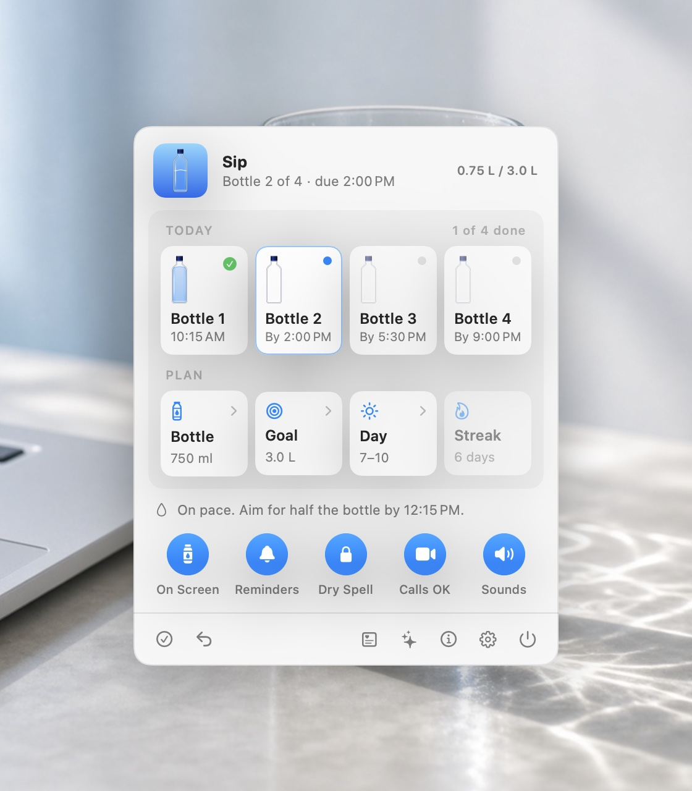

<p align="center">
  
</p>

<h1 align="center">Sip</h1>

<p align="center">
  Finish your water bottle on time, or your Mac takes a water break.<br>
  A water bottle that lives in the corner of your Mac’s screen.
</p>

<p align="center">
  macOS 14 Sonoma or later · Free and open source (MIT)
</p>

<p align="center">
  
</p>

---

You know you should drink more water. You fill your bottle in the morning, and at 4 PM it’s still mostly full. Reminder apps don’t help, because a notification is easy to swipe away.

**Sip** turns your daily water into a few bottles, each with a time to finish it. A bottle stands on your screen and fills up as you finish your real bottles, so you can see at a glance how much you’ve had today. If you haven’t finished a bottle well past its time, the screen locks for a short water break until you do.

<p align="center">
  
  &nbsp;
  
</p>

## Features

### Your bottle, your plan

- **Built around the bottle you actually own.** Pick 500, 600, 750, or 1000 ml, or set any size in 50 ml steps. Sip counts bottles, not sips, so you never have to guess how many milliliters you drank. It only ever asks: is the bottle empty?
- **A goal for men, women, or you.** Start from 3.0 L of drinks a day for men or 2.2 L for women, or set your own amount. If you exercise most days or live somewhere hot, add 0.5 L.
- **A schedule from your day.** Tell Sip when you wake up and go to bed. It splits your goal into bottles across the day and stops an hour before bed, so you sleep through the night. With a 750 ml bottle, 3 L, and a 7 AM to 10 PM day, that’s four bottles, due by 10:30 AM, 2:00 PM, 5:30 PM, and 9:00 PM.
- **Uneven goals still work.** If the goal doesn’t divide evenly by your bottle, the last one says how far to fill it. For example, 2.2 L from a 500 ml bottle is five bottles, with the last one filled to 200 ml.

<p align="center">
  
</p>

### Reminders that get firmer

- **The bottle fills with your day.** Sip can’t see your real bottle, so it doesn’t guess. When you empty yours, hover over the bottle on screen and click **Drink**. The water rises by one bottle toward today’s goal (with four bottles, each one fills it a quarter). Under the bottle, a caption shows which bottle you’re on, when to finish it, and today’s total. Five seconds after you stop hovering, the bottle tucks away into a small row of bottles; hover over the row to bring it back. The menu bar panel can undo a click.
- **A bottle you can tilt.** On a MacBook, the bottle leans toward the low side by as much as you tilt the laptop, and past about 50 degrees it tips over and lies on its side, while the water inside stays level and keeps its volume. It sloshes when you bump it, open or close the lid, or drag the bottle across the screen, and splashes when a bottle refills. Sip reads the built-in accelerometer and lid sensor, and needs no permission to do it.
- **Put it anywhere.** Drag the bottle wherever you like and it stays there. It starts on the right side, above the bottom-right corner, so it doesn’t cover apps like Where’d It Go?. **Settings › Bottle on screen** puts it back on the left or right side.
- **Reminders on the bottle itself.** No cards or banners. Halfway through each bottle, the bottle’s bar wiggles with a soft sound and says when to finish it; the line goes away on its own. Opening Sip partway through a bottle doesn’t count as news, so nothing pops up when it starts.
- **A firmer one when it’s due.** When a bottle is due, the bar wiggles with a chime, turns orange, and says when to drink it by to keep your Mac unlocked. It wiggles again every couple of minutes until you click **Drink**.

<p align="center">
  
</p>

### The Dry Spell

If a bottle still isn’t empty 10 minutes after it’s due, every display goes behind frosted glass for 15 minutes. The Dock and menu bar hide and app switching is off. One click on **Bottle’s empty** ends it right away. If the time runs out and the bottle still isn’t finished, the lock comes back 20 minutes later.

- **Never at a bad moment.** Sip doesn’t lock while your camera or microphone is in use, while you’re away from the Mac (screen locked, asleep, or five minutes without a key press or mouse move), or in the hour before bed. Time away doesn’t count against you.
- **Always a way out.** On any display, press and hold the bottle’s cap: it unscrews, and after three seconds it pops off and the screen unlocks. Or press **Esc** three times to unlock in an emergency; that bottle won’t lock your Mac again. The lock also ends on time on its own, and if Sip ever stops responding while the screen is covered, it quits itself so the cover goes away.
- **Your rules.** Choose a 5 to 20 minute lock and a 5 to 30 minute grace period after a bottle is due, or turn the Dry Spell off and keep just the reminders. **Settings › Try it for 20 seconds** shows you what it looks like.

<p align="center">
  
</p>

### Why water

- **One reason, at the right moment.** The lock screen shows one short fact about what water does for you, with its source. The fact changes with each bottle and each day, and some depend on the time: before lunch, a glass before a meal helps you feel full; in the afternoon, a slump can be mild dehydration.
- **A small reward.** When you finish a bottle, its caption shows what it’s good for, like “Bottle 2 done · helps keep headaches away”.
- **Only what the evidence supports.** The **Why water?** page lists every benefit Sip mentions, each with a study or guideline behind it: focus and mood, headaches, kidney stones, keeping cool, digestion, bladder infections, and feeling full. No claims about flushing toxins or clearing skin.

<p align="center">
  
</p>

### Menu bar

Click the water drop in the menu bar, or Sip’s icon in the Dock, to open a small panel. The Dock icon helps when a full menu bar hides the drop behind the camera notch; switch to **Menu bar only** in Settings if you don’t want it.

- **Today.** Every bottle of the day: finished ones with the time you finished them, the current one draining, and the rest with their due times. The header shows how much you’ve drunk so far.
- **Your plan.** Bottle size, daily goal, your day, and your streak of days in a row with the goal met. Click a tile to change it.
- **Quick switches.** Round toggles for **On Screen** (keep the bottle in the corner), **Reminders**, **Dry Spell**, **Calls OK** (never lock during calls), and **Sounds**.
- **Everything else, one click away.** Mark the bottle empty, undo, open Why water?, replay setup, and open Settings or Quit.

<p align="center">
  
</p>

## Install

1. Download **[Sip.zip](https://github.com/deepujain/sip/releases/latest/download/Sip.zip)** (macOS 14 or later, Apple silicon and Intel).
2. Open the zip and drag **Sip.app** into your **Applications** folder.
3. Open it. The app isn’t notarized by Apple yet, so the first time macOS says it can’t verify the developer. Open **System Settings › Privacy & Security**, scroll down, and click **Open Anyway**. You only need to do this once.

Setup opens first. Pick your bottle, your goal, and your day, then click **Start**. The bottle appears on the right side of the screen, a water drop appears in the menu bar, and Sip’s icon appears in the Dock. If you don’t see the drop, your menu bar is full and macOS has hidden it behind the camera notch: click the Dock icon instead, or hold **⌘** and drag other menu bar icons to make room. Sip needs no permissions.

Sip isn’t medical advice. If you have kidney or heart problems, or take water pills, ask your doctor how much to drink.

## Build from source

Requires macOS 14 or later and Swift 6 (Xcode or the Command Line Tools).

```sh
git clone https://github.com/deepujain/sip.git
cd sip
./build.sh
```

This builds a universal release binary, assembles `build/Sip.app` with its icon, and signs it for local use. Run `./build.sh debug` for a debug build, or `./package.sh` to produce the downloadable `build/Sip.zip`.

## How it works

- Splits your daily goal into bottles and gives each one time in proportion to how much it holds, from when you wake up until an hour before bed.
- Shows the bottle and the reminder card in borderless, non-activating panels, so they never steal focus.
- The Dry Spell covers every display with a window above everything else and turns off the Dock, the menu bar, and app switching until you finish the bottle or the time runs out.
- Moves the water with a small spring model driven by the MacBook’s accelerometer (through the Apple sensor hub’s HID interface) and lid angle sensor. Sip turns the sensor hub’s reporting on while it runs and restores its earlier settings when it quits. On Macs without these sensors, the water still sloshes when you drag the bottle.
- Knows when you’re on a call by asking Core Audio and Core Media I/O whether the microphone or camera is in use, and knows when you’re away from screen lock, sleep, and input idle time.
- Keeps 60 days of finished bottles in its own preferences for your streak. Built with SwiftUI and AppKit. No dependencies, no network access, no analytics.

## Project layout

```
Sources/Sip/
  App/       App entry point, windows, the app icon artwork
  Model/     The daily plan, the reminder and lock logic, and the water benefits
  System/    Call and away detection, and the motion sensors behind the sloshing water
  UI/        Bottle, menu panel, desktop bottle, reminder card, lock screen, setup, and Why water
  Debug/     Debug-only snapshot renderer for reviewing the UI
Resources/   Info.plist
build.sh     Builds and signs the .app
package.sh   Builds the downloadable zip
```

## License

MIT © 2026 1xAI. See [LICENSE](LICENSE).
